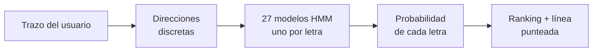
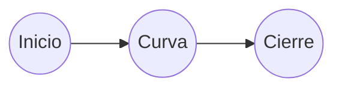
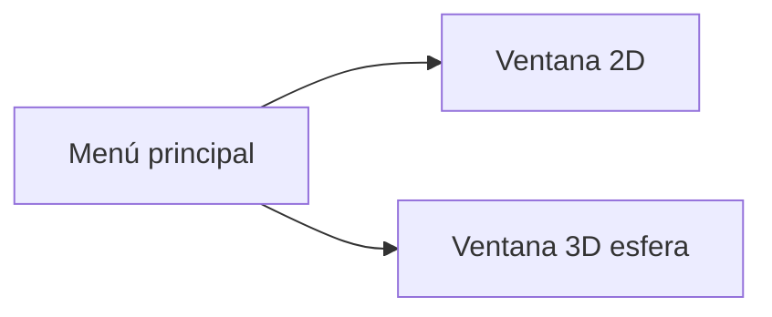

# Glifo

**Reconocedor de letras manuscritas en tiempo real (2D y 3D) con Cadenas Ocultas de Markov.**

Proyecto Final · Procesos Estocásticos (603504) · Universidad de los Llanos · Ingeniería de Sistemas

---

## ¿Qué hace?

Dibujas una letra con el ratón y la aplicación:

1. **Adivina** qué letra es, mientras la dibujas (27 letras minúsculas del alfabeto español).
2. **Muestra** un ranking con la probabilidad de cada letra.
3. **Autocompleta** el trazo con una línea punteada que predice cómo seguiría la letra.

Funciona en dos modos: sobre un **plano 2D** y sobre una **esfera 3D**.
---

##

Una letra se dibuja como una secuencia de movimientos: "abajo, abajo, derecha, arriba...". Cada letra tiene su propio patrón.

- **Lo que vemos (observaciones):** la dirección del trazo en cada instante.
- **Lo que no vemos (estados ocultos):** en qué parte de la letra va el usuario (inicio, curva, cierre...).

Un **HMM** modela justamente eso. Entrenamos **uno por letra** y vemos cuál explica mejor el trazo actual.



---

## Cómo funciona

### 1. Convertir el trazo en símbolos
Cada paso del cursor se convierte en una de **8 o 16 direcciones** (Chain Code).
En 3D, los puntos de la esfera se pasan a ángulos (θ, φ) y se hace lo mismo con sus variaciones.

### 2. Un modelo HMM por letra
Cada modelo está definido por λ = (A, B, π):

| Elemento | Qué significa |
|---|---|
| **A** | Probabilidad de pasar de una fase del trazo a la siguiente |
| **B** | Probabilidad de ver cada dirección en cada fase |
| **π** | Probabilidad de empezar en cada fase |


$$\hat c = \arg\max_c P(O_{1:t} \mid \lambda_c)$$

### 3. Autocompletado
Con el modelo de la letra ganadora se toman las fases que faltan, se obtiene la dirección más probable de cada una y se dibuja ese camino desde el cursor.

---

## Pantallas



Cada ventana tiene el **lienzo a la izquierda** y el **ranking de letras a la derecha**, con botones para limpiar y reiniciar.

---

## Estructura del proyecto

```
TrazoHMM/
├── main.py
├── src/
│   ├── HMMEngine.py          # Forward, Viterbi, Baum-Welch, proyección
│   ├── FeatureExtractor.py   # Chain Code y coordenadas esféricas
│   └── GUI.py                # Ventanas e interacción
├── training/                 # Scripts de entrenamiento offline
├── models/                   # Modelos entrenados (.json)
└── data/                     # Trazos de ejemplo por letra
```
