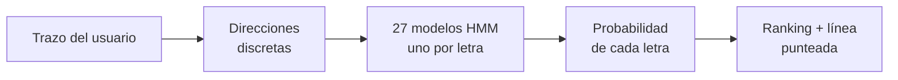
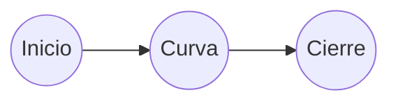
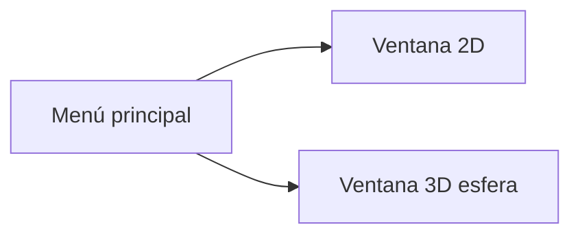

# Glifo

**Reconocedor de letras manuscritas en tiempo real (2D y 3D) con Cadenas Ocultas de Markov.**

Proyecto Final · Procesos Estocásticos (603504) · Universidad de los Llanos · Ingeniería de Sistemas

> **Estado:** la primera entrega cubre el modo **2D**. El modo 3D (esfera) llega en la segunda entrega.

---

## ¿Qué hace?

Dibujas una letra con el ratón y la aplicación:

1. **Adivina** qué letra es, mientras la dibujas (27 letras minúsculas del alfabeto español).
2. **Muestra** un ranking con la probabilidad de cada letra.
3. **Autocompleta** el trazo con una línea punteada que predice cómo seguiría la letra.

Funciona en dos modos: sobre un **plano 2D** y sobre una **esfera 3D**.

---

## La idea: ¿por qué un HMM?

Una letra se dibuja como una secuencia de movimientos: "abajo, abajo, derecha, arriba...". Cada letra tiene su propio patrón.

- **Lo que vemos (observaciones):** la dirección del trazo en cada instante.
- **Lo que no vemos (estados ocultos):** en qué parte de la letra va el usuario (inicio, curva, cierre...).

Un **HMM** modela justamente eso. Entrenamos **uno por letra** y vemos cuál explica mejor el trazo actual.



---

## Cómo funciona

### 1. Convertir el trazo en símbolos
Cada tramo del trazo se convierte en una de **8 direcciones** (Chain Code, K = 8):

| 0 | 1 | 2 | 3 | 4 | 5 | 6 | 7 |
|---|---|---|---|---|---|---|---|
| → | ↗ | ↑ | ↖ | ← | ↙ | ↓ | ↘ |

Antes de cuantizar, el trazo se suaviza y se remuestrea por **longitud de arco** (un punto cada 3 % del lienzo), de modo que la velocidad con la que se dibuja no cambia la secuencia. Detalles en [`docs/contrato_features.md`](docs/contrato_features.md).

### 2. Un modelo HMM por letra
Cada modelo está definido por λ = (A, B, π):

| Elemento | Qué significa |
|---|---|
| **A** | Probabilidad de pasar de una fase del trazo a la siguiente |
| **B** | Probabilidad de ver cada dirección en cada fase |
| **π** | Probabilidad de empezar en cada fase |


$$\hat c = \arg\max_c P(O_{1:t} \mid \lambda_c)$$

### 3. Autocompletado
Con el modelo de la letra ganadora se toman las fases que faltan, se obtiene la dirección más probable de cada una y se dibuja ese camino desde el cursor.

---

## Pantallas



Cada ventana tiene el **lienzo a la izquierda** y el **ranking de letras a la derecha**, con botones para limpiar y reiniciar.

---

## Requisitos

| Qué | Detalle |
|---|---|
| **Python** | 3.9 o superior (probado con 3.13) |
| **Extractor, datos y pruebas** | Solo usan la librería estándar de Python |
| **HMMEngine** | Usa NumPy (ver `requirements.txt`) |
| **GUI** | Según la tecnología que elija el equipo (p. ej. Tkinter, que viene con Python; en Linux: `sudo apt install python3-tk`) |

```bash
pip install -r requirements.txt
```

> En Windows, si `python` no responde, usa `py` en su lugar.

---

## Cómo ejecutar

Todos los comandos se lanzan **desde la raíz del proyecto**.

### Pruebas

```bash
python -m unittest discover -s tests -v
```

### Revisar el dataset

```bash
python training/check_data.py
```

Muestra cuántas muestras hay por letra (la meta de Glifo Capture es 70; se cambia con `--meta`), cuántos símbolos genera cada una y avisa de trazos demasiado cortos, de longitud atípica o fuera de la escala esperada.

### Generar las secuencias de entrenamiento

```bash
python training/build_sequences.py                 # K=8, 20 % para prueba
python training/build_sequences.py --holdout 0     # todo a entrenamiento (modelo final)
```

Lee el `data/glifo-dataset-*.json` más reciente y crea `data/secuencias_2d_k8.json`, que consume el entrenamiento del HMM. Cada muestra del dataset es `letra → muestras → trazos → [x, y, t_ms]`, con `x`, `y` en la escala 0–1000 relativa al lienzo de Glifo Capture (no son píxeles).

> **Regenerar con `python training/build_sequences.py` cada vez que cambie el dataset.** `secuencias_2d_k8.json` es un archivo generado: si el dataset cambia y no se vuelve a crear, queda desactualizado sin que nadie lo note.

---

## Estructura del proyecto

```
TrazoHMM/
├── main.py                       # (pendiente)
├── src/
│   ├── FeatureExtractor.py       # Chain Code, remuestreo, símbolos <-> puntos
│   ├── HMMEngine.py              # (pendiente) Forward, Viterbi, Baum-Welch, proyección
│   └── GUI.py                    # (pendiente) Ventanas e interacción
├── training/
│   ├── dataset.py                # Lector del JSON del dataset
│   ├── check_data.py             # Revisión de calidad de los datos
│   └── build_sequences.py        # Dataset -> secuencias de símbolos
├── tests/
│   ├── test_features.py          # Pruebas del extractor
│   └── test_dataset.py           # Pruebas del lector y de build_sequences
├── docs/
│   └── contrato_features.md      # Contrato entre módulos
├── models/                       # (pendiente) Modelos entrenados (.json)
├── data/
│   ├── glifo-dataset-*.json      # Trazos de ejemplo
│   └── secuencias_2d_k8.json     # Secuencias GENERADAS (regenerar si cambia el dataset)
├── requirements.txt
├── .gitattributes                # Finales de línea LF
└── .gitignore
```
