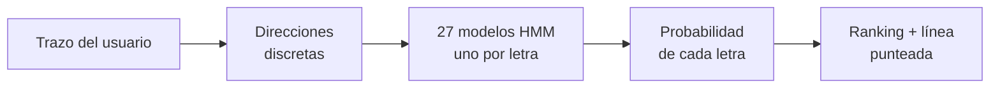
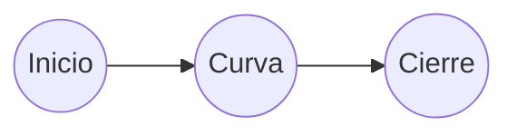
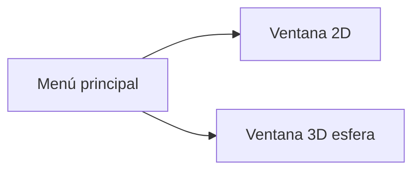

# Glifo

**Reconocedor de letras manuscritas en tiempo real (2D y 3D) con Cadenas Ocultas de Markov.**

Proyecto Final · Procesos Estocásticos (603504) · Universidad de los Llanos · Ingeniería de Sistemas

> **Estado:** funcionan los dos modos: **2D** (lienzo plano) y **3D** (esfera que se gira y se acerca).

---

## ¿Qué hace?

Dibujas una letra con el ratón y la aplicación:

1. **Adivina** qué letra es, mientras la dibujas (27 letras minúsculas del alfabeto español).
2. **Muestra** un ranking con la probabilidad de cada letra.
3. **Autocompleta** el trazo con una línea punteada que predice cómo seguiría la letra.

Funciona en dos modos: sobre un **plano 2D** y sobre una **esfera 3D**.

---

## La idea: ¿por qué un HMM?

Una letra se dibuja como una secuencia de movimientos: "abajo, abajo, derecha, arriba...". Cada letra tiene su propio patrón.

- **Lo que vemos (observaciones):** la dirección del trazo en cada instante.
- **Lo que no vemos (estados ocultos):** en qué parte de la letra va el usuario (inicio, curva, cierre...).

Un **HMM** modela justamente eso. Entrenamos **uno por letra** y vemos cuál explica mejor el trazo actual.



---

## Cómo funciona

### 1. Convertir el trazo en símbolos
Cada tramo del trazo se convierte en una de **8 direcciones** (Chain Code, K = 8):

| 0 | 1 | 2 | 3 | 4 | 5 | 6 | 7 |
|---|---|---|---|---|---|---|---|
| → | ↗ | ↑ | ↖ | ← | ↙ | ↓ | ↘ |

Antes de cuantizar, el trazo se suaviza y se remuestrea por **longitud de arco** (un punto cada 3 % del lienzo), de modo que la velocidad con la que se dibuja no cambia la secuencia. Detalles en [`docs/contrato_features.md`](docs/contrato_features.md).

### 2. Un modelo HMM por letra
Cada modelo está definido por λ = (A, B, π):

| Elemento | Qué significa |
|---|---|
| **A** | Probabilidad de pasar de una fase del trazo a la siguiente |
| **B** | Probabilidad de ver cada dirección en cada fase |
| **π** | Probabilidad de empezar en cada fase |


$$\hat c = \arg\max_c P(O_{1:t} \mid \lambda_c)$$

### 3. Autocompletado
Con el modelo de la letra ganadora se toman las fases que faltan, se obtiene la dirección más probable de cada una y se dibuja ese camino desde el cursor.

---

## Pantallas



Cada ventana tiene el **lienzo a la izquierda** y el **ranking de letras a la derecha**, con botones para limpiar y reiniciar.

La ventana 2D tiene:

- **Lienzo** con las cuatro líneas guía (ascendente, altura x, línea base y descendente), en las mismas proporciones que Glifo Capture.
- **Proyección punteada** de lo que le falta a la letra más probable, que se actualiza con cada símbolo nuevo. Se ajusta a lo que ya dibujaste: arranca en el cursor y termina donde le corresponde a TU letra (su tamaño y su línea base).
- **Ranking** de P(c | O₁:ₜ): las 4 letras más probables y el resto agrupado.
- **«Trazo no definido»** cuando el trazo no se parece a ninguna letra. En ese caso no se dibuja proyección.
- **«Guía de letras»**: anima cada letra trazo por trazo, en orden y con sus números, como la guía de Glifo Capture. Es el diseño del propio dataset (ver «La guía de dibujo» más abajo).

La ventana 3D tiene la misma estructura, con una **esfera** como lienzo:

- **Controles:** clic izquierdo dibuja, clic derecho (o el botón del medio) gira la esfera, la rueda acerca o aleja. «Centrar vista» la devuelve a como empezó, sin borrar.
- **«Arriba» es siempre el borde superior del panel**, gire como gire la esfera. Las líneas guía se quedan fijas en pantalla.
- **Solo cuenta la cara que se ve.** Si se gira y parte de la letra queda detrás, esa parte se ignora mientras no se vea.
- Los puntos se pasan a **coordenadas esféricas (θ, φ)** y los símbolos salen de las variaciones (Δθ, Δφ) sobre la superficie (ver `docs/contrato_features.md`).
- La **proyección punteada** se dibuja pegada a la superficie y gira con la esfera.
- Usa **sus propios modelos**, entrenados con un dataset 3D sintético hecho a partir del 2D (ver «Modo 3D» más abajo).

Atajo: `Esc` vuelve al menú.

---

## Requisitos

| Qué | Detalle |
|---|---|
| **Python** | 3.9 o superior (probado con 3.13) |
| **Extractor, datos y pruebas** | Solo usan la librería estándar de Python |
| **HMMEngine** | Usa NumPy (ver `requirements.txt`) |
| **GUI** | PySide6 (Qt 6). Las fuentes van incluidas en `assets/fonts` |
| **Esfera 3D** | OpenGL 2.1 o superior, con las clases de Qt (no hay que instalar nada más). En Windows, si la tarjeta no tiene OpenGL, Qt usa su renderizador por software |

```bash
pip install -r requirements.txt
```

> En Windows, si `python` no responde, usa `py` en su lugar.

---

## Cómo ejecutar

Todos los comandos se lanzan **desde la raíz del proyecto**.

### La aplicación

```bash
python GUI.py
```

Al abrir el modo 2D se cargan los modelos de `data/modelos_letras_entrenados.json`. Los del modo 3D (`data/modelos_letras_3d.json`) se cargan la primera vez que se entra a la esfera; tarda unos segundos.

### Entrenar los modelos HMM

```bash
python training/entrenar_hmms.py
```

Entrena con Baum-Welch los 27 modelos a partir de `data/secuencias_2d_k8.json` y los guarda en `data/modelos_letras_entrenados.json`.

### Modo 3D: dataset sintético y modelos

Solo hay dataset 2D, así que el del modo 3D se fabrica a partir de él:

```bash
python training/build_sequences_3d.py          # pega cada muestra 2D sobre la esfera -> data/secuencias_3d_k8.json
python training/entrenar_hmms.py --modo 3d     # entrena los 27 modelos 3D -> data/modelos_letras_3d.json
```

Cada muestra se pega varias veces sobre la cara visible de la esfera, con posición, tamaño (±30 %) y giro (±8°) al azar, enrollando el lienzo sobre la superficie con el mapa exponencial. El reparto entrenamiento/prueba es **por muestra** y se hace antes de pegarlas: ninguna muestra de prueba aparece en el entrenamiento, ni siquiera en otro lugar de la esfera.

Acierto de los modelos 3D sobre la prueba 3D (996 secuencias): **91.6 %** solo con el HMM y **93.1 %** con el término de largo que usa la app (ver «Cómo decide la letra»). Los modelos 2D sobre esa misma prueba dan 92.4 % solo con el HMM: con el dataset de un diseño por letra ya toleran bien la curvatura. Con el dataset anterior, más chico, los modelos 3D sí ganaban (87.8 % contra 85.6 %).

### La guía de dibujo

```bash
python training/generar_guia.py                          # -> data/guia_trazos.json (la usa la app)
python training/generar_guia.py --js ../Glifo-Capture-Pages/docs/guia.js   # además, la de Glifo Capture
```

La guía sale **del dataset**: cada trazo es el trazo mediano de todas las muestras de la letra (remuestreadas por longitud de arco), suavizado con curvas de Bézier. Así enseña exactamente el diseño con el que aprenden los modelos. Con la guía hecha a mano, que no coincidía con el dataset en la «x», la «k», la «d», la «p» o la «y», quien la seguía tenía 85.6 % de acierto; con la generada, 98.6 % en 2D y 99.5 % en 3D. **Volver a generarla cada vez que cambie el dataset** (`tests/test_guia.py` avisa si quedó desactualizada).

### Cómo decide la letra

Mientras se dibuja se compara la probabilidad de que el trazo sea el **comienzo** de cada letra. Al levantar el lápiz se suman dos términos (ver `HMMEngine.classify`), con pesos elegidos sobre las secuencias de **entrenamiento**:

| Término | Peso | Para qué |
|---|---|---|
| El modelo termina en su último estado, log α_T(N) | 0.2 | Que una letra terminada no se confunda con el comienzo de otra más larga |
| El largo de la secuencia, log N(T; media, desviación de la letra) | 2 | El HMM modela mal las duraciones: sin esto, la «n» absorbía el palito largo de la «h» |

Acierto sobre el 20 % de prueba (2D): 90.6 % sin estos términos, 93.8 % con el primero y **95.8 %** con los dos. Se probó también entrenar con copias deformadas (aumento de datos) y empeoró (92.0 %), así que no se usa.

### Pruebas

```bash
python -m unittest discover -s tests -v
```

### Revisar el dataset

```bash
python training/check_data.py
```

Muestra cuántas muestras hay por letra (la meta de Glifo Capture es 70; se cambia con `--meta`), cuántos símbolos genera cada una y avisa de trazos demasiado cortos, de longitud atípica o fuera de la escala esperada.

### Generar las secuencias de entrenamiento

```bash
python training/build_sequences.py                 # K=8, 20 % para prueba
python training/build_sequences.py --holdout 0     # todo a entrenamiento (modelo final)
```

Lee el `data/glifo-dataset-*.json` más reciente y crea `data/secuencias_2d_k8.json`, que consume el entrenamiento del HMM. Cada muestra del dataset es `letra → muestras → trazos → [x, y, t_ms]`, con `x`, `y` en la escala 0–1000 relativa al lienzo de Glifo Capture (no son píxeles).

> **Regenerar con `python training/build_sequences.py` cada vez que cambie el dataset.** `secuencias_2d_k8.json` es un archivo generado: si el dataset cambia y no se vuelve a crear, queda desactualizado sin que nadie lo note.

---

## Estructura del proyecto

```
Glifo/
├── GUI.py                        # Punto de entrada: python GUI.py
├── src/
│   ├── FeatureExtractor.py       # Chain Code, remuestreo, símbolos <-> puntos, coordenadas esféricas
│   ├── HMMEngine.py              # Forward, Backward, Baum-Welch, Viterbi, clasificación y proyección
│   └── gui/                      # Interfaz (PySide6)
│       ├── main_window.py        # Secciones: menú, 2D y 3D
│       ├── menu_view.py          # Ventana A: menú principal
│       ├── view_2d.py            # Ventana B: reconocedor 2D
│       ├── view_3d.py            # Ventana C: reconocedor 3D (esfera)
│       ├── canvas_2d.py          # Lienzo con líneas guía y proyección
│       ├── canvas_3d.py          # Esfera con OpenGL: dibujar, girar, acercar
│       ├── ranking_panel.py      # Listado de probabilidades
│       ├── guide_popup.py        # Guía de letras (animada)
│       ├── guia_trazos.py        # Lee la guía de dibujo y la convierte en puntos
│       ├── recognizer.py         # Puente FeatureExtractor + HMMEngine
│       ├── recognizer_3d.py      # El mismo puente para la esfera (marco de la vista, solo lo visible)
│       ├── widgets.py            # Componentes visuales compartidos
│       └── theme.py              # Colores, fuentes y estilos
├── training/
│   ├── dataset.py                # Lector del JSON del dataset
│   ├── check_data.py             # Revisión de calidad de los datos
│   ├── build_sequences.py        # Dataset -> secuencias de símbolos
│   ├── build_sequences_3d.py     # Dataset 2D -> secuencias 3D sintéticas sobre la esfera
│   ├── generar_guia.py           # Guía de dibujo a partir del dataset (trazo mediano por letra)
│   └── entrenar_hmms.py          # Entrena y exporta los 27 modelos HMM (--modo 2d | 3d)
├── tests/
│   ├── test_features.py          # Pruebas del extractor
│   ├── test_features_3d.py       # Pruebas de la geometría esférica
│   ├── test_dataset.py           # Pruebas del lector y de build_sequences
│   ├── test_sequences_3d.py      # Pruebas del dataset 3D sintético
│   ├── test_recognizer.py        # Pruebas del puente GUI <-> HMM
│   ├── test_recognizer_3d.py     # Pruebas del reconocedor 3D
│   └── test_guia.py              # Quien sigue la guía es reconocido
├── docs/
│   └── contrato_features.md      # Contrato entre módulos
├── assets/fonts/                 # Selawik, Playwrite AR (a y q) e Inconsolata (OFL)
├── data/
│   ├── glifo-dataset-*.json      # Trazos de ejemplo
│   ├── secuencias_2d_k8.json     # Secuencias GENERADAS (regenerar si cambia el dataset)
│   ├── secuencias_3d_k8.json     # Secuencias 3D sintéticas GENERADAS
│   ├── guia_trazos.json          # Guía de dibujo GENERADA del dataset
│   ├── modelos_letras_entrenados.json  # Modelos HMM del modo 2D
│   └── modelos_letras_3d.json    # Modelos HMM del modo 3D
├── requirements.txt
├── .gitattributes                # Finales de línea LF
└── .gitignore
```
